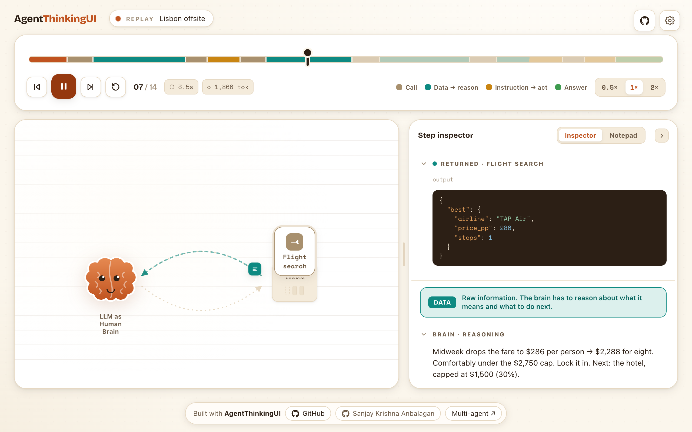

<h1 align="center">Agentfootprint</h1>

<p align="center">
  <strong>Build agents whose answers can be checked.</strong>
</p>

<p align="center">
  A TypeScript agent framework for connecting answers to recorded evidence, making uncertainty explicit,
  and checking outputs before delivery. Configure what an answer must support and when to withhold it.
</p>

<p align="center">
  Built on <a href="https://github.com/footprintjs/footPrint">FootprintJS execution provenance</a>:
  context, tool calls, results and decisions become connected records as the agent runs.<br/>
  Build with tools, skills, memory, RAG and orchestration; use that record for answer checks, debugging and review.
</p>

<p align="center">
  <a href="#what-can-this-answer-support">Evidence and limits</a> ·
  <a href="#checks-you-can-enable">Checks and guarantees</a> ·
  <a href="#how-this-compares-with-langchain-and-mastra">Framework comparison</a> ·
  <a href="#quick-start--runs-offline-no-api-key">Quick start</a>
</p>

<p align="center">
  <a href="https://github.com/footprintjs/agentfootprint/actions"></a>
  <!-- coverage-badge --><!-- /coverage-badge -->
  <a href="https://www.npmjs.com/package/agentfootprint"></a>
  <a href="https://bundlephobia.com/package/agentfootprint"></a>
  <a href="#tree-shakeable--esm-first"></a>
  <a href="https://www.npmjs.com/package/agentfootprint"></a>
  <a href="https://github.com/footprintjs/agentfootprint/blob/main/LICENSE"></a>
</p>

---

## What can this answer support?

A tool returned no rows. Before an agent says **"there are no incidents"**, the app
needs to know which account was searched, what period the read covered, whether it
finished, and what it could not reach. A successful empty query and a failed query
support different answers.

For example, the bounded claim is: **"The search returned no matching incidents
for this account and time window. Email reports were not checked."** That is an
illustration of scope-aware wording, not a claim that no incident exists anywhere.
When the evidence cannot support the requested conclusion, the app should make
that uncertainty explicit or withhold the answer.

Agentfootprint supplies the execution record and configurable checks for that
decision. Your app defines the comparisons and delivery policy. Tool declarations
must describe the query truthfully: recording a source's assertion does not prove
the source is correct.

## How evidence reaches the answer

1. **Record what ran.** FootprintJS connects execution steps and data dependencies;
   Agentfootprint records the context supplied, tools called and results returned.
2. **Preserve the limits.** Tools declare absence, coverage and time boundaries.
   Configure those limits to travel with the answer instead of relying on the model
   to repeat them.
3. **Check before delivery.** Opt-in answer validation compares the candidate with
   evidence under app-authored rules. Enforce mode withholds failed or unverified
   candidates; the host decides how to explain the refusal to the user.
4. **Inspect the same run.** Review recorded inputs, results, decisions and checks,
   or replay the execution to investigate a failure.

Execution provenance describes what ran and what was supplied. It does not expose
the model's internal reasoning or independently establish that an external fact
is true. Withholding an answer does not undo tool actions already performed.

## Checks you can enable

Installing the framework does not make every answer verified. These mechanisms
have different jobs and must be configured for the claims your app needs to check.

| Mechanism | What it provides | Boundary of the guarantee |
|---|---|---|
| [`absent()`, `coverage()` and `.limitsTravelWithTheAnswer()`](#what-a-tool-returns--three-helpers-one-rule) | Explicit absence and declared limits, carried into prose or returned beside typed output. | Preserves declarations; does not prove that the tool described its coverage correctly. |
| [`.answerValidation()`](docs-next/content/docs/build/output-schema.mdx#check-the-answer-against-evidence) | App-authored checks on a typed final answer. Enforce mode buffers drafts and withholds failed or unverified answers; observe mode records the report and permits delivery. | Only the configured checks are judged. The app owns their correctness and the trustworthiness of its evidence. |
| [`.namesAndNumbersFromEvidence()`](docs-next/content/docs/build/evidence-gate.mdx) | A deterministic detector for unsupported values, with configurable extraction limits and delivery postures. | Default `assist` flags; `rails` refuses. A false sentence assembled from real values can pass. This is not general factual verification. |
| [`Tool.search` and typed `.negativeClaims()`](docs-next/content/docs/build/negative-claims.mdx) | Composed search scope and library-written statements for cited structured negative claims, retaining gaps and withholding or reporting unsupported claims according to policy. | **Opt-in, available but not recommended pending benchmark gates.** Accuracy and usefulness remain unmeasured. Depends on truthful app-owned search declarations; other answer fields remain unchecked model text. |
| [`.negativeClaims({ prose: true })`](docs-next/content/docs/build/negative-claims.mdx) | Bounded heuristic warnings on the model's own negative sentences. | Never verifies, blocks or rewrites an answer. The previous detector failed its benchmark; the revised path is unmeasured. No warning does not mean verified. |

The links above describe this branch. Features marked **unreleased** in the
[capability index](CAPABILITIES.md) are not yet available in the published package;
check its availability column and the [release notes](CHANGELOG.md) for your
installed version. The basic quick start below does not enable these checks.

## How this compares with LangChain and Mastra

These frameworks all support agent building and runtime controls. The useful
distinction is what each emphasizes, rather than whether it has guardrails.

| Framework | Emphasis and existing runtime controls |
|---|---|
| **LangChain / LangGraph** | Model and tool integrations, agent loops and stateful orchestration with persistence and human oversight. [LangGraph](https://docs.langchain.com/oss/javascript/langgraph/overview) covers execution; [LangChain guardrails](https://docs.langchain.com/oss/javascript/langchain/guardrails) can check inputs, outputs and tool calls during a run. |
| **Mastra** | A TypeScript framework for agent applications, with workflows, memory, development tools, tracing and evaluations. Its [input/output processors](https://mastra.ai/docs/agents/processors) can validate or transform messages during execution. [Overview](https://mastra.ai/docs). |
| **Agentfootprint** | Agent building organized around FootprintJS execution provenance: connected execution records, declared evidence limits, and [configured checks](#checks-you-can-enable) that can govern answer delivery. |

Choose Agentfootprint when a central requirement is to connect an answer to what
the agent actually read, the limits of that evidence, and the checks applied before
delivery. Skills, tools and orchestration build the agent; the execution record
also supports its answer policy. This comparison describes design emphasis, not
exclusive capabilities or measured superiority in answer accuracy.

## Quick start — runs offline, no API key

```bash
npm install agentfootprint footprintjs
```

```typescript
import { Agent, defineTool } from 'agentfootprint';
import { mock } from 'agentfootprint/providers';

const weather = defineTool({
  name: 'weather',
  description: 'Get current weather for a city.',
  inputSchema: {
    type: 'object',
    properties: { city: { type: 'string' } },
    required: ['city'],
  },
  execute: async ({ city }: { city: string }) => `${city}: 72°F, sunny`,
});

const agent = Agent.create({
  provider: mock({
    replies: [
      { toolCalls: [{ id: 'weather-1', name: 'weather', args: { city: 'Paris' } }] },
      { content: 'The demo weather tool returned 72°F and sunny for Paris.' },
    ],
  }),
  model: 'mock',
})
  .system('You answer weather questions using the weather tool.')
  .tool(weather)
  .build();

const result = await agent.run({ message: 'Weather in Paris?' });
console.log(result);  // → "The demo weather tool returned 72°F and sunny for Paris."
```

The tool runs locally and the mock scripts its call and reply. The temperature is
fixture data, not a live weather reading; this example demonstrates wiring, not
answer validation. For a configured delivery check, run the [mock answer-validation
example](examples/features/99-guard-presented-code.ts).

To use a real model, replace the scripted mock with a provider from
`agentfootprint/providers` — `anthropic(...)` / `openai(...)` / `bedrock(...)` /
`gemini(...)` / `ollama(...)` — and configure its model and any required credentials.
The agent and tool wiring stays the same. Every provider, including `mock`, lives
on that subpath so the main barrel stays free of optional provider SDK imports.

**No cloud account?** `ollama('llama3.2')` from `agentfootprint/providers` runs the same agent against a local model for $0 — the free rung between the mock and the bill. Full recipes: [Ollama](https://agentfootprint.dev/docs/build/ollama/) · [OpenAI-compatible endpoints](https://agentfootprint.dev/docs/build/openai/#openai-compatible-endpoints-ollama-llamacpp-vllm-together-groq-lm-studio).

## What a tool returns — three helpers, one rule

Whatever a tool returns is what the model reads next. When that value has limits the model must not lose, return it through one of three helpers — each is the tool's response; nothing is added to the system prompt or the tool's schema:

| helper | use it when | the model reads | the record keeps |
|---|---|---|---|
| `describedResult({ … })` | rows, a series or relationships from a system of record | the data, with `grain`, `provenance` and one `not_covered` line per gap | the whole envelope (`tools.semantics_declared`) |
| `coverage(value, { … })` | any other value that has limits | your value, with what was and was not checked | `tools.coverage_declared` |
| `absent({ … })` | nothing matched | what was looked for, where, and that a retry returns the same | `tools.absent` |

Never wrap one in another. Add `.limitsTravelWithTheAnswer()` and the declared coverage is appended to the final answer — or, for a typed `.outputSchema()` answer, returned beside it as data by `agent.answerCoverage()`. Provenance and grain never are.

```typescript
import { absent, coverage, describedResult } from 'agentfootprint';

execute: ({ vm, summary }) => {
  const { exportedAt, source, runs: all } = backupExport;   // your system of record
  const runs = all.filter((r) => r.vm === vm);
  const ground = { checked: [`every backup job in the export of ${exportedAt}`] };
  if (runs.length === 0) return absent({ what: `backup runs for ${vm}`, ...ground });  // nothing matched
  if (summary) return coverage(`${vm}: ${runs.length} backup runs`, ground);           // a verdict with limits
  return describedResult({                                                             // rows from the record
    facts: runs.map((r) => ({ entity: vm, day: r.day, ok: r.ok === 1 })),
    provenance: { measuredAt: exportedAt, source },   // the time comes from the data
    coverage: ground,
  });
},
```

What the model reads from each, exactly: [Tools → what `execute` returns](https://agentfootprint.dev/docs/build/tools/#what-execute-returns--three-helpers-one-rule).

## Building agents — context, tools and orchestration

Skills, steering, RAG, facts, memory, guardrails — every name for context does one thing: it injects into one of three LLM slots. So we abstracted the injection itself.

<p align="center">
  <picture>
    <source media="(prefers-color-scheme: dark)" srcset="docs/assets/hero-dark.svg">
    <source media="(prefers-color-scheme: light)" srcset="docs/assets/hero-light.svg">
    
  </picture>
</p>
<p align="center">
  <sub><em>One primitive: <code>Injection = slot × trigger × cache</code>. Because the framework owns this point, every piece of context is <b>born tracked</b> — observability isn't wired up, it's a consequence of the abstraction. <a href="#the-4-triggers">The 4 triggers ↓</a></em></sub>
</p>

<p align="center">
  <picture>
    <source media="(prefers-color-scheme: dark)" srcset="docs/assets/triggers-dark.svg">
    <source media="(prefers-color-scheme: light)" srcset="docs/assets/triggers-light.svg">
    
  </picture>
</p>

The abstraction is three rules:

1. **Three slots are fixed.** `system`, `messages`, `tools` — the LLM API surface.
2. **N flavors are open.** You declare what you have. Tomorrow's flavor (few-shot, reflection, persona, A2A handoff…) plugs in the same way.
3. **Rules decide *where* and *when*.** You provide the rules. We collect your data, fire the right one, land it in the right slot at the right iteration.

That's the whole model: `Injection = slot × trigger × cache`.

- **Slot** — which of the 3 LLM API regions the content lands in (`system` / `messages` / `tools`).
- **Trigger** — when the content fires (see below).
- **Cache** — how stable the content is across iterations. The framework places provider cache markers for you — stable content gets 80–90% cheaper prefixes.

### The 4 triggers

| Trigger | Flavor | Fires when | Illustration | Default slot |
|---|---|---|---|---|
| `always` | static | Every iteration | `.steering(defineSteering({ id, prompt: 'You are a triage agent…' }))` | `system` |
| `rule` | runtime — predicate | Your rule returns true | `.instruction(defineInstruction({ id, activeWhen: s => /price\|refund/.test(s.userQuery), prompt }))` | `system` |
| `on-tool-return` | runtime — lifecycle | After a specific tool returns | `.instruction(defineInstruction({ id, activeWhen: s => s.lastToolResult?.toolName === 'search', prompt: 'Cite source IDs.' }))` | `system` |
| `llm-activated` | runtime — agent-driven | LLM calls `read_skill('id')` | `.skill(defineSkill({ id: 'refund-policy', description, body }))` | `system` (body) + `tools` |

**3 slots × 4 triggers × N flavors = the entire context-engineering surface.**

## Inspect and replay the evidence

The recorded run also supports debugging. These examples illustrate different
kinds of evidence; a similarity score or recorded dependency alone is not proof
of why a model chose an answer.

<p align="center">
  <a href="https://footprintjs.github.io/agentThinkingUI/">
    
  </a>
</p>
<p align="center">
  <sub>A run replayed with <a href="https://github.com/footprintjs/agentThinkingUI"><b>Story Lens</b></a> (<code>npm i agentthinkingui</code>). Frames are generated from the run's trace; <a href="https://footprintjs.github.io/agentThinkingUI/">▶ watch it live</a>.</sub>
</p>

```text
Q: Were refund_full and refund_partial described similarly?
A: margin 0.02 — ⚠ NARROW: the two tool descriptions read nearly identical
   (toolChoiceRecorder — and the catalog lint flags the pair before you ever run)

Q: Why was this loan declined?
A: decision ← [control: "DTI above the 0.43 affordability ceiling"] ← dti 0.52 ← monthlyDebt / income
   (decide() evidence + the causal slice — every hop is a real recorded edge)

Q: Did removing a piece of context change the outcome in these reruns?
A: ablating fact 'vip-override' flipped the outcome in 3/3 seeded reruns
   (localizeContextBug — evidence from those counterfactual trials)

Q: Does this exported bundle pass its integrity check?
A: verifyAuditBundle → valid: false, brokenAt: #16 — the tampered record, named
   (hash-chained audit export, offline verification)
```

The trace toolpack also lets a debugger model inspect the record: in one run it
found a planted bug while reading **9.5% of the trace**
([self-explain](https://agentfootprint.dev/docs/debug/self-explain/)). That is one
debugging result, not an answer-accuracy benchmark. Integrity checks establish
properties of the exported record; they do not establish that its source data was true.

## Pick your door

| Checking answers? | Building an agent? | Inspecting a run? |
|---|---|---|
| Declare the evidence and limits; configure checks and the response to uncertainty. | Typed agents with skills, steering, RAG, memory and control flow. | Recorded dependencies, counterfactual reruns, replay and audit-bundle integrity checks. |
| [→ Checks and guarantees](#checks-you-can-enable) · [→ Output contracts](docs-next/content/docs/build/output-schema.mdx) | [→ Quick start](https://agentfootprint.dev/docs/getting-started/quick-start/) · [→ Build an agent](https://agentfootprint.dev/docs/build/agent/) | [→ Debug](https://agentfootprint.dev/docs/debug/debug/) · [→ Exporters & audit bundles](https://agentfootprint.dev/docs/monitor/exporters/) |

## Mocks first, production second

Build the entire app against in-memory mocks with **zero API cost**, then swap real infrastructure one boundary at a time.

| Boundary | Dev | Prod |
|---|---|---|
| LLM provider | `mock(...)` | `ollama('<model>')` free · `anthropic()` · `openai()` · `bedrock()` |
| Memory store | `InMemoryStore` | `RedisStore` · `AgentCoreStore` |
| MCP | `mockMcpClient(...)` | `mcpClient({ transport })` |
| Cache strategy | `NoOpCacheStrategy` | auto-selected per provider |

The flowchart, recorders, and tests don't change between dev and prod.

## Any AG-UI frontend — no glue code

AG-UI frontends (CopilotKit, the AG-UI Dojo, any `@ag-ui/client` app) all speak one protocol: POST a `RunAgentInput`, read a stream of typed events. An agentfootprint run is already a stream of typed events, so the only missing piece is the adapter between them — `agUi()`. Hand it to `streamHandler`, a plain `(request) => Promise<Response>` that mounts in Next.js, Hono, Bun, Deno or Workers, and the frontend shows streamed text, tool calls with their results, steps and sub-agents.

A browser request is untrusted, so the handler decides nothing on its word: it builds a fresh agent for every request, binds the thread to the caller *your* verifier proves (`verifiedThreads` — a checked bearer token or sign-in, never a header read as a name), keeps the conversation on the server (`sessions`) and takes only the person's newest message from the page. It reads only what the run *serves*, so anything your redaction policy hides never reaches the browser.

```ts
// npm install agentfootprint @ag-ui/core @ag-ui/encoder
import { Agent } from 'agentfootprint';
import { mock } from 'agentfootprint/providers';
import { memorySessions, streamHandler, verifiedThreads } from 'agentfootprint/hosting';
import { agUi } from 'agentfootprint/ag-ui';

// Who is calling — PROVEN, not claimed. A real app: jwksIdentity({ jwksUrl, issuer, audience })
// from 'agentfootprint/security'. This demo verifier knows one token.
const verify = async (token: string) => {
  if (token !== 'demo-token-for-ada') throw new Error('unknown token');
  return { userId: 'ada' };
};

const handler = streamHandler({
  // A fresh agent per request — nothing one caller's run leaves behind reaches another.
  agent: () =>
    Agent.create({ provider: mock({ reply: 'Hello from agentfootprint.' }), model: 'mock' })
      .system('Be brief.')
      .build(),
  adapter: agUi(),
  threads: verifiedThreads({ verify }), // no valid token → 401; the thread is the caller's own
  sessions: memorySessions(), // the conversation lives on the server (one turn per thread, per process)
}); // Next.js: export const POST = handler;

// What an AG-UI frontend sends, and what it reads back:
const response = await handler(
  new Request('http://localhost/agent', {
    method: 'POST',
    headers: { 'content-type': 'application/json', authorization: 'Bearer demo-token-for-ada' },
    body: JSON.stringify({ threadId: 't1', runId: 'r1', messages: [{ id: 'u1', role: 'user', content: 'Hi' }] }),
  }),
);
console.log(await response.text()); // data: {"type":"RUN_STARTED",…} … data: {"type":"RUN_FINISHED",…}
```

Two turns with a tool call, end to end: [`examples/deploy/ag-ui.ts`](examples/deploy/ag-ui.ts) · frontend tools, interrupts, what a page may not decide, and what goes out: [AG-UI frontends](https://agentfootprint.dev/docs/infrastructure/ag-ui/).

## Building with an AI coding assistant

agentfootprint is written to be used — and maintained — by coding agents.

- **Teach your assistant the API:** `npx agentfootprint-setup` installs the agentfootprint skill for Claude Code (and rule files for Cursor, Copilot, Windsurf, Cline, Kiro). It loads only when the task is about agentfootprint.
- **Before building something, search [CAPABILITIES.md](CAPABILITIES.md)** — an index of what already ships, keyed by what *you* would call it. It is in the npm package too.
- **Every example runs:** [`examples/`](examples/) holds 160+ runnable programs, each executed end to end in CI against mock providers.

## Where to next

| If you are... | Go here |
|---|---|
| New to agents | [5-minute quick start](https://agentfootprint.dev/docs/getting-started/quick-start/) |
| Coming from LangChain / CrewAI / LangGraph | [Migration guide](https://agentfootprint.dev/docs/getting-started/vs/) |
| Architecting an enterprise rollout | [Production guide](https://agentfootprint.dev/docs/monitor/deployment/) |
| Doing due diligence | [Architecture overview](https://agentfootprint.dev/docs/reference/dependency-graph/) |
| Researcher / academic background | [Citations & prior art](https://agentfootprint.dev/docs/reference/citations/) |
| Curious about design | [Inspiration docs](https://agentfootprint.dev/docs/reference/inspiration/) |

Or jump into the [examples gallery](https://github.com/footprintjs/agentfootprint/tree/main/examples) — every example is also an end-to-end CI test.

## Tree-shakeable & ESM-first

- **Dual build, true ESM** — CommonJS and real ES modules with TypeScript types; loads natively under Node, Vite, Next, Deno and Bun.
- **Per-file modules, honest `sideEffects`** — `import { defineTool }` doesn't pull in the Agent runtime, memory stores or providers.
- **Entry points named for what you're doing** — `agentfootprint` plus `/providers`, `/memory`, `/rag`, `/observe`, `/context`, `/resilience`, `/security`, `/hosting`, `/events`, `/cache` and a few more; `package.json` `exports` is the complete list.
- **Lazy peer-deps** — vendor SDKs (Anthropic, AWS, Redis, MCP…) load only when you instantiate that adapter, and optional families like the self-explain toolpack load only when enabled.

Proven by tests, not promised: [`test/esm-packaging.test.ts`](test/esm-packaging.test.ts) and [`test/trace-toolpack/browserGraph.test.ts`](test/trace-toolpack/browserGraph.test.ts).

## Built on

[footprintjs](https://github.com/footprintjs/footPrint) — the flowchart pattern for backend code. agentfootprint's decision-evidence capture, narrative recording, and time-travel checkpointing are footprintjs primitives at the runtime layer.

You don't need to learn footprintjs to use agentfootprint — but if you want to build your own primitives at this depth, [start there](https://footprintjs.github.io/footPrint/).

---

## Citing

agentfootprint is part of a research program on making software systems explain themselves — every run records *why* it did what it did, as a causal trace. Researching agent transparency, observability, or explainable AI? The [ecosystem map](https://footprintjs.github.io/) is a good starting point.

If you use agentfootprint in academic work, please cite it (or use the "Cite this repository" button on GitHub):

```bibtex
@software{anbalagan_agentfootprint,
  author  = {Anbalagan, Sanjay Krishna},
  title   = {agentfootprint: the explainable AI agent framework},
  url     = {https://github.com/footprintjs/agentfootprint},
  license = {MIT},
  year    = {2025}
}
```

---

## License

[MIT](./LICENSE) © [Sanjay Krishna Anbalagan](https://github.com/sanjay1909)
