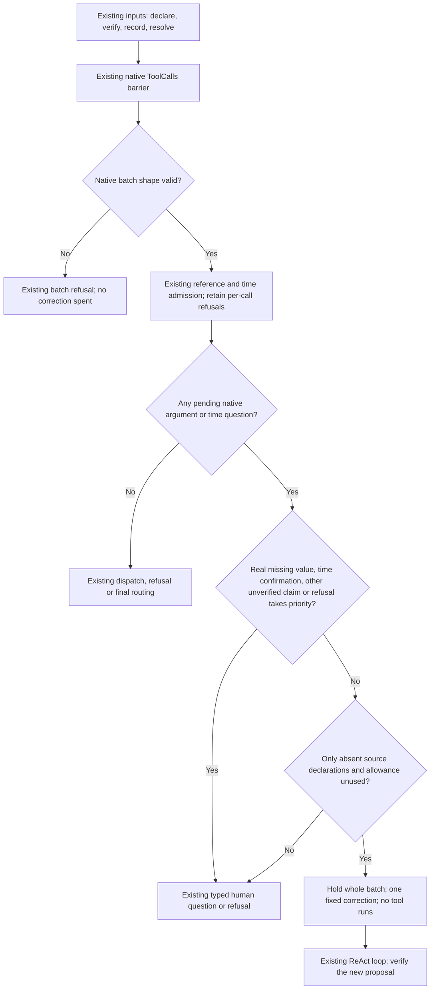

When the person's message already names a value, a model can propose the right tool argument while omitting its `_findings.from` declaration. The library cannot infer that declaration. With `declarationCorrection: 'once'`, the existing inputs layer can request one new proposal with an actual declaration before raising the ordinary human question.

<CodeFile
  path="examples/features/122-source-declaration-correction.ts"
  region="source-correction"
  title="Native source declaration correction, using a free mock"
/>

The first proposal runs no tool. Every call in that proposed batch is held, including otherwise valid siblings. The native ToolCalls stage returns correlated framework feedback and continues through the existing ReAct loop. The new proposal passes the same source checks as any ordinary call. The parent `_findings` property remains optional.

This diagram explains decisions inside existing native owners; enabling the option adds no executor, provider retry policy, timer or flowchart stage.

For a present scalar value under an ask rule, only an absent source declaration qualifies: an omitted parent, a valid empty `from` list or a valid list missing this argument. Scalars are strings, booleans and finite numbers. A malformed declaration, a false quote, an explicit assumed value, a model reading, an unavailable result or a genuinely missing argument keeps its ordinary question/refusal behavior. The library never fills a source claim from a matching hint.

One opportunity belongs to the whole human request, across calls and fields. Repeated omission raises the ordinary typed human question. Same-request native pause/crash recovery preserves the used allowance, including a newly created Agent restored from its checkpoint. A genuine new human turn starts a fresh allowance. Keep checkpoints in the application's trusted host; schema validation does not authenticate caller-authored checkpoints.

Both hosting strategies use this same native state: keep a conversation Agent in a pool, or create an Agent from the same configuration and restore the accepted native checkpoint. Neither strategy needs another cache or retry manager. An active same-request spent checkpoint cannot be restored on a configuration with correction disabled.

The trace retains a masked omission observation. A `correction: 'source-declaration-required'` argument row means the batch was actually held for correction; `withheld: 'batch-preempted'` means a native admission refusal took precedence. Neither invents a source or a human question, and neither earns source-check execution credit. An actual human fallback uses the ordinary `asked` row. Previously completed failures remain recorded.

Framework notices contain fixed protocol feedback, never argument values or inferred sources. Their committed native history has zero producer bytes and `toolResultOrigin: 'not-entered'`; these internal fields are removed from provider requests. Notices are excluded from offered results and person/app/result evidence. Existing argument views, quote masking and native redaction still apply.

The correction consumes an ordinary native iteration. Existing iteration, request, output, cancellation, deadline and liveness bounds remain in force. A source check establishes that bytes trace to the claimed place; it cannot prove the answer used the relevant entity. Applications must still send current selection context clearly and use their normal selection-change tests.
