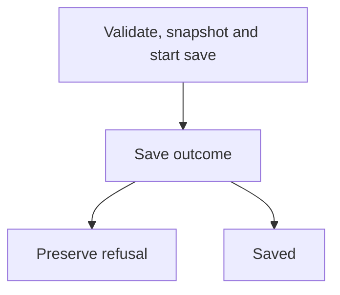
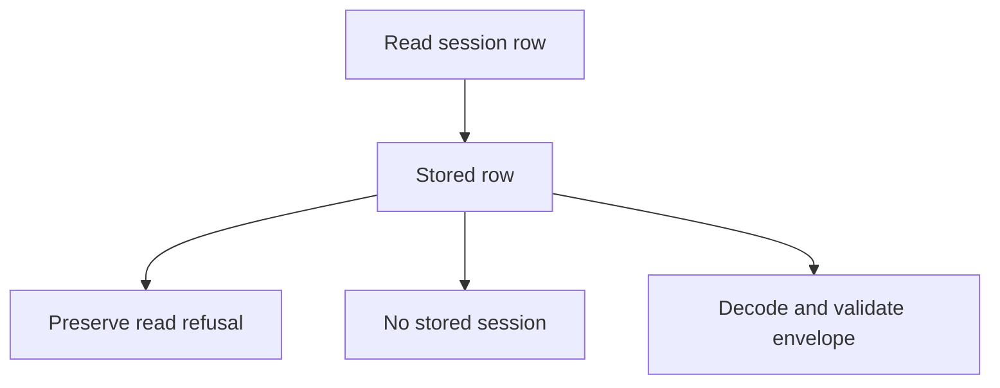
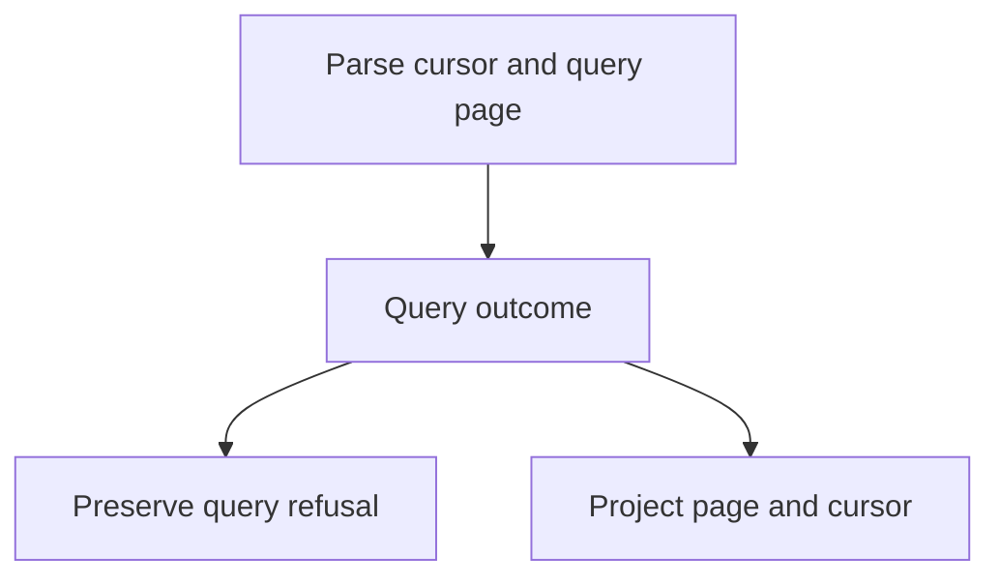
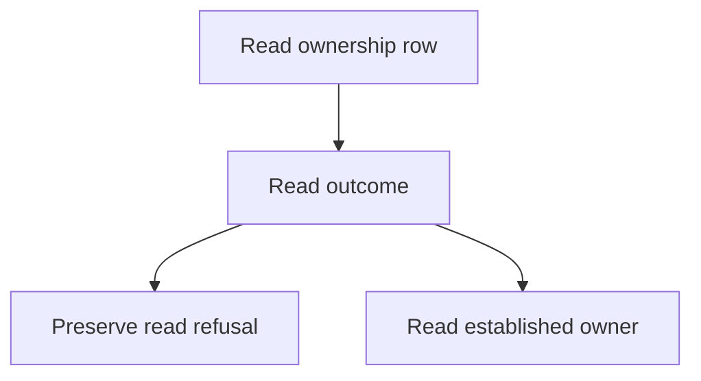
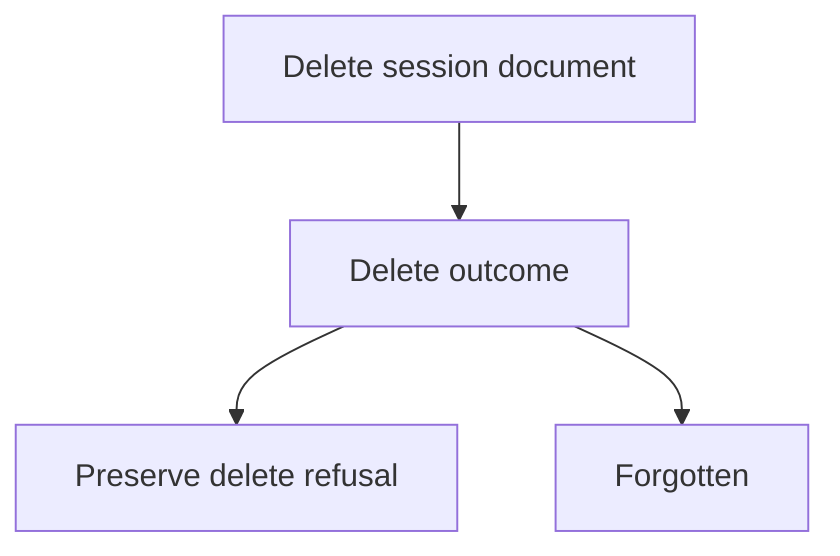
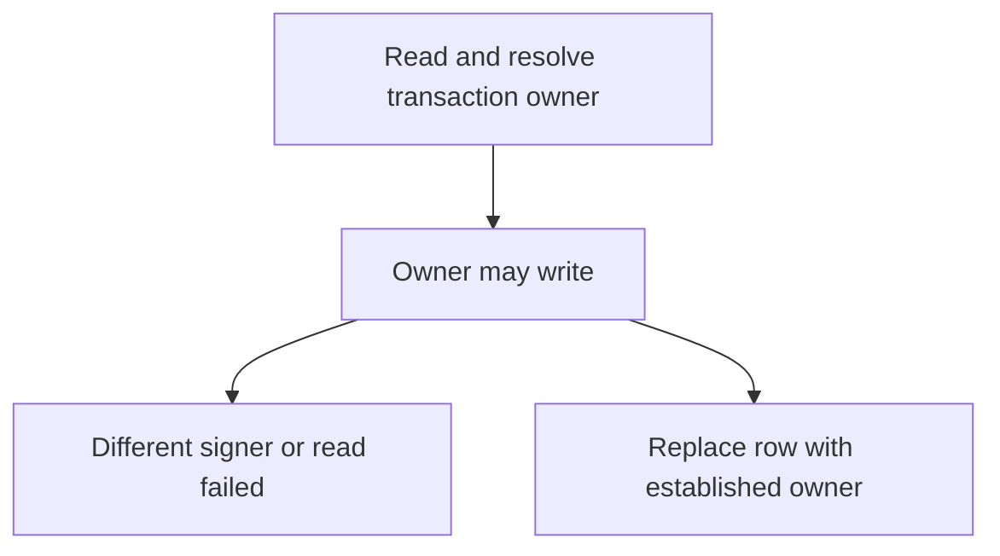
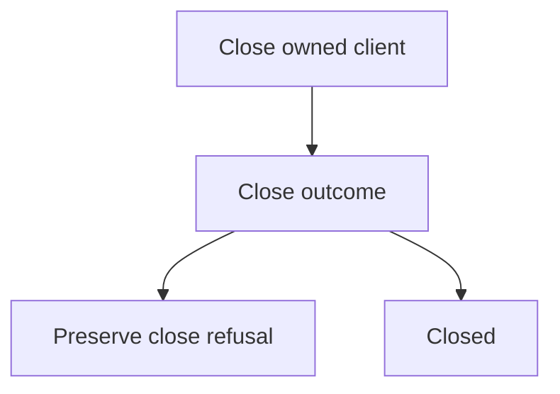

**Support** — the Firestore implementation of the session lifecycle port.

One collection, one document per session. The public index keeps the existing
names; backend, address, retention and error helpers are whole-unit moves.
The pilot charts will keep save/load/list/delete validation, transaction
ownership, size and cursor rules in the recorded path, with no new public API.

The synchronous prefix of save remains one first stage: validate, serialize,
refuse size, derive the row and start the SDK transaction before returning.
Firestore owns transaction retry. Each callback runs the ownership chart anew;
there is no extra retry policy. Inputs, SDK objects and errors stay outside
recorded state; only bounded facts and decision reasons belong in the record.

The existing SDK-double and session conformance assertions remain the behavior
contract. Explicit private `.js` imports need `/index.js` after a folder move;
the package hosting door and its exports remain unchanged. No forwarding shim.

## Example

```ts
import { firestoreSessions } from 'agentfootprint/hosting';
const sessions = firestoreSessions({ collection: 'conversations' });
await sessions.persist(sessionId, envelope);
const restored = await sessions.hydrate(sessionId);
await sessions.close();
```

## Executable drawings

These drawings come from the built charts' `toMermaid()` and are pinned by
`src/adapters/hosting/firestoreSessions/chart.test.ts`. Transaction retries are owned by
Firestore: every callback gets its own ownership run, rather than a second
retry loop. The original validation/snapshot/request-start prefix remains a
single first stage to preserve synchronous side effects.

<!-- charts:start -->
### saveChart



### hydrateChart



### listChart



### ownerChart



### forgetChart



### ownershipChart



### closeChart


<!-- charts:end -->

The refused-save example is the real native run in
`bench/results/firestore-refused-save.json`. It records bytes and the ceiling,
not the envelope. The error retains its original class, fields and sentence.
The capability input is deliberately untracked; this is a bounded explanation,
not a complete causal recording of caller data or a public diagnostics API.
