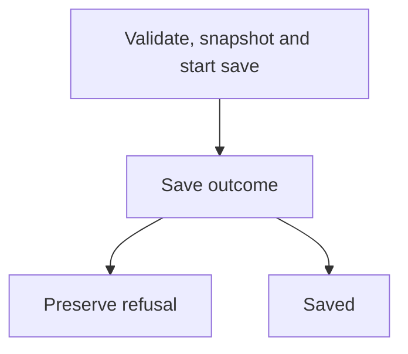
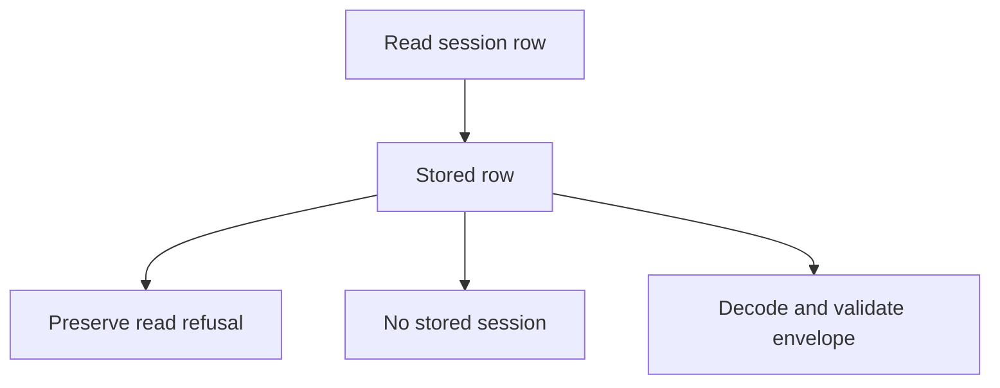
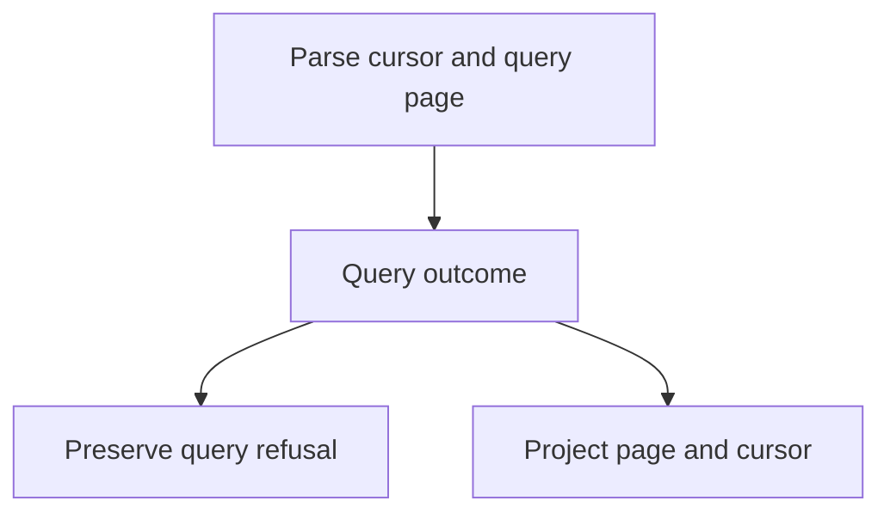
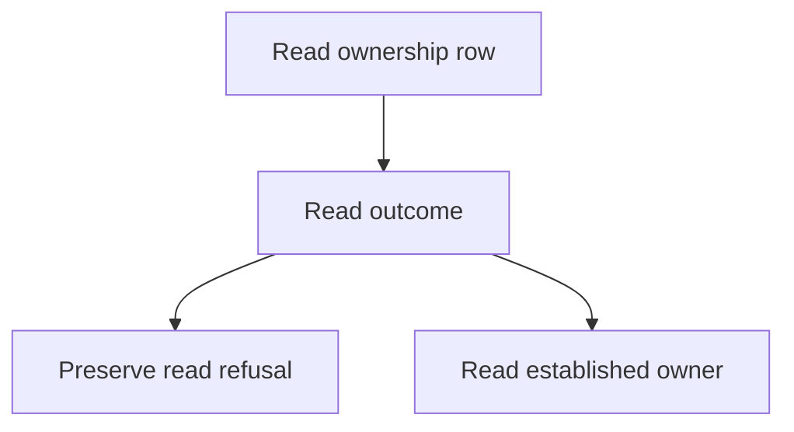
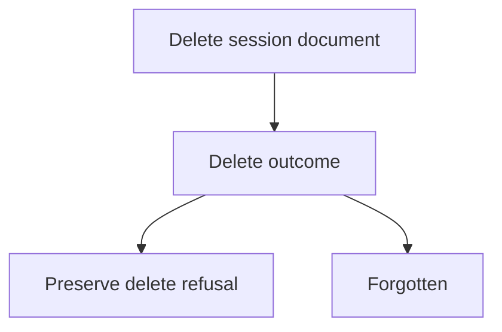
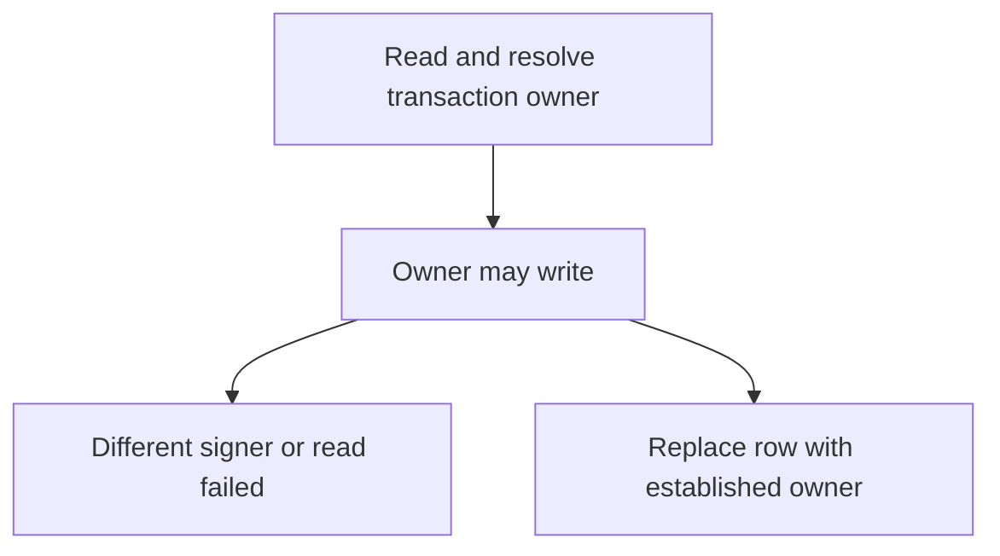
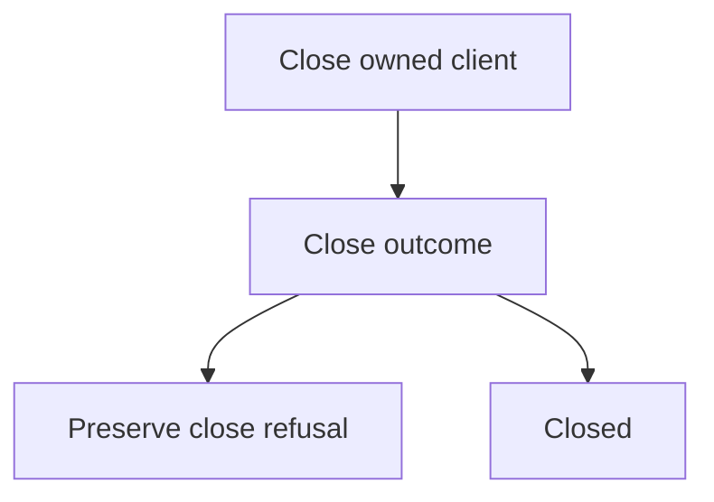

**Support** — the Firestore implementation of the session lifecycle port.

One collection, one document per session. The public index keeps the existing
names; backend, address, retention and error helpers are whole-unit moves.
The pilot charts run save/load/list/delete validation, transaction ownership,
size and cursor rules, with no new public API. The public factory does not
attach an observer or retain a debug record. A private test observer can capture
a snapshot; its limits are described below.

The synchronous prefix of save remains one first stage: validate, serialize,
refuse size, derive the row and start the SDK transaction before returning.
Firestore owns transaction retry. Each callback runs the ownership chart anew;
there is no extra retry policy. Inputs, SDK objects and errors stay outside
recorded state. The private snapshot contains bounded facts and reason codes;
decision labels do not reach it, and the branch rationale only names the branch.

The existing SDK-double and session conformance assertions remain the behavior
contract. Explicit private `.js` imports need `/index.js` after a folder move;
the package hosting door and its exports remain unchanged. No forwarding shim.

## Example

```ts
import { firestoreSessions } from 'agentfootprint/hosting';
const sessions = firestoreSessions({ collection: 'conversations' });
await sessions.persist(sessionId, envelope);
const restored = await sessions.hydrate(sessionId);
await sessions.close();
```

## Executable drawings

These drawings come from the built charts' `toMermaid()` and are pinned by
`src/adapters/hosting/firestoreSessions/chart.test.ts`. Transaction retries are owned by
Firestore: every callback gets its own ownership run, rather than a second
retry loop. The original validation/snapshot/request-start prefix remains a
single first stage to preserve synchronous side effects.

<!-- charts:start -->
### saveChart



### hydrateChart



### listChart



### ownerChart



### forgetChart



### ownershipChart



### closeChart


<!-- charts:end -->

The refused-save artifact in `bench/results/firestore-refused-save.json` is a
private test demonstration, not a debug record retained by the public store.
`chart.test.ts` attaches an observer to the private `buildStore` factory to
capture an actual native snapshot. The public `firestoreSessions` factory
supplies no observer, so it neither retains nor exposes that snapshot.

The snapshot contains bytes, the ceiling and the `envelope-too-large` reason
code, not the envelope. The size-rule label is absent; the recorded decision
rationale is only `returned branchId: refuse`. The artifact's `sentence` is
constructed by the test from the thrown error and the observed absence of a
transaction call; it is not generated from the run record. The error retains
its original class, fields and sentence. The capability input is deliberately
untracked, so this is not a complete causal recording of caller data.

Pilot requirement 4 (a saved run record that explains the refused save) remains
unmet for the public store. The chart pattern and record design remain on hold
for the owner's decision; this demonstration does not establish a production
debug log or authorize a new recording API.
