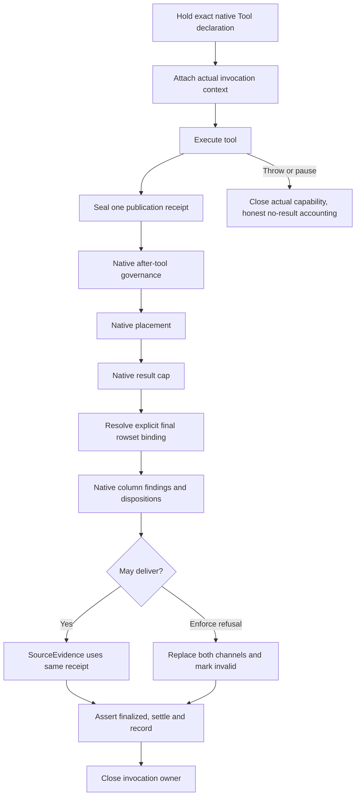

**Mixed** — explicit final-result binding and its native lifecycle.
Walker: `finalization.ts` owns one actual invocation through return, withdrawal,
final judgment and cleanup. `read.ts` uses bounded native artifact readers.
Fold: `judge.ts` reuses the existing pure column judge and finding/disposition rail.
Lens: `inlineRows.ts` detaches bounded own data without executing serialization hooks.

## Native execution order

The existing FootprintJS ToolCalls stage remains the execution owner. There is
no second runner, source query, metadata-only dispatch or application validator.

Ordinary dispatch and all three executing resume doors use this order. Human
plain-pause answers are not producer executions. Successful armed returns must
cross the finalization assertion before tool_end/history; closing is not a
blanket not-applicable fallback that could hide a disconnected judge. A native
argument pause accounts only the actual wholly undispatched current batch.

The publication receipt contains immutable bounded metadata only, keyed by the
actual ToolArtifacts capability. SourceEvidence and rowsets read the same
getter; neither consumes the other's authority. Close seals even a capability
that never acquired a sink. Late writes, another invocation, repeated provider
IDs and descriptive origin fields cannot manufacture membership.

Only final served content and explicit paths are read. Placement of the whole
wrapper may make a binding unavailable; no original payload, preview, history
or guessed ticket is resurrected. Native head/get enforce scope, expiry and
digest. An additional final head checks availability after the bounded read.
All published bindings in one final tool call share one 5000 ms native wait
budget, implemented by the existing linked cancellation/deadline helpers.
Completed encounters remain real; a stalled binding and remaining bindings
become unavailable, with no retries or further reads. Parent cancellation wins
and late reads cannot file. SourceEvidence retains its separate configured
capture timeout; the rowset budget does not require mounting SourceEvidence.
Record redaction does not suppress an authorized backend computation; native
record serving remains responsible for masking recorded values.

Selected inline rowsets are limited to 1000 row objects,1 MiB and 16 data levels. They
preserve primitive values, undefined and genuine Dates; they never call
getters, iterators or toJSON. This protection applies at the new final-reader
boundary, not to every existing native producer/middleware envelope reader.
The outer own-data snapshot separately allows one content envelope, the declared
path and those 16 row-data levels, at most 33 levels total; it does not reduce
which declared 16-segment paths can actually reach their rows.
Published datasets retain the existing strict bounded JSON reader. Static
declarations are limited to 8 entries,16 path segments and 8192 bytes.

Unavailable bindings file both old check kinds as not-applicable and emit a
finite value-free rowset_checked event. They never invent a missing-column or
sample finding. Empty arrays and canonical absence remain not-applicable.
Warn preserves delivery; enforce uses a fixed invalid teaching refusal, which
still passes the native result cap. Legacy resultColumns keeps its original
pre-governance check and absent rowset identity exactly.
