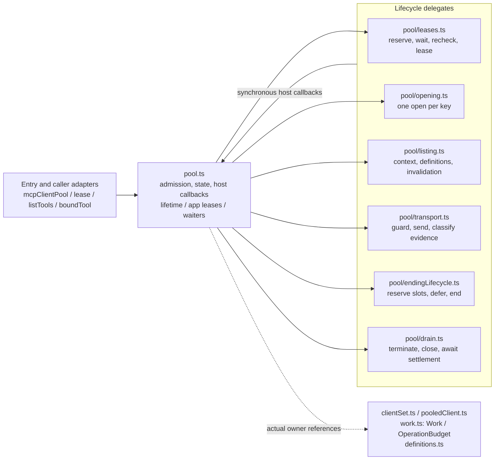

**Mixed** — one MCP client per authenticated conversation, for one server: who holds which client, what is charged, and what ends when.
Walker: `pool.ts` owns lifecycle state and wires its delegates; Lens: `errors.ts` and `sessionEnded.ts` own fixed served refusals.

Start at [`mcpClientPool.ts`](mcpClientPool.ts), then [`pool.ts`](pool.ts) for admission, authoritative state and synchronous callback wiring. Follow the relevant owner below instead of reading every lifecycle at once.

The diagram shows existing wiring, not a recorded runtime chart or a fixed sequence every operation follows. Solid arrows are delegation or synchronous host callbacks; the dotted arrow is access to the same canonical owners. Cross-owner calls return through `Pool`, not direct delegate imports. The linked table below provides code and tests; viewers that enable Mermaid interactions can also use the node links.

`listTools` and `boundTool` orchestrate lease and listing calls through the facade; leases do not call listing. Opening requests the guarded transport seam through its host, and transport routes tools-changed invalidation back through the facade. The table links the canonical state owners and the tests for each path. This documentation makes no measured token-saving claim.

| Question                                                   | Code owner                                                                                                                                                                   | Behavior controls                                                                                                                                         |
| ---------------------------------------------------------- | ---------------------------------------------------------------------------------------------------------------------------------------------------------------------------- | --------------------------------------------------------------------------------------------------------------------------------------------------------- |
| Is an operation admitted, and when does its charge return? | `pool.ts` admission → [`work.ts`](work.ts)                                                                                                                                   | [`operations`](../../../test/mcp/pool/operations.test.ts), [`sendGate`](../../../test/mcp/pool/sendGate.test.ts)                                          |
| Which incarnation opens or takes a lease?                  | [`pool/opening.ts`](pool/opening.ts), [`pool/leases.ts`](pool/leases.ts) over [`clientSet.ts`](clientSet.ts), [`pooledClient.ts`](pooledClient.ts), [`plan.ts`](plan.ts)     | [`open-once`](../../../test/mcp/pool/open-once.test.ts)                                                                                                   |
| Which clients can end or make room?                        | [`pool/endingLifecycle.ts`](pool/endingLifecycle.ts), [`pool/drain.ts`](pool/drain.ts) over the same sets and budget                                                         | [`capacity`](../../../test/mcp/pool/capacity.test.ts), [`churn`](../../../test/mcp/pool/churn.test.ts), [`expiry`](../../../test/mcp/pool/expiry.test.ts) |
| Is a served tool still bound to its list and identity?     | [`pool/listing.ts`](pool/listing.ts), [`listTools.ts`](listTools.ts), [`boundTool.ts`](boundTool.ts), [`definitions.ts`](definitions.ts), [`identityKey.ts`](identityKey.ts) | [`binding`](../../../test/mcp/pool/binding.test.ts), [`definitions`](../../../test/mcp/pool/definitions.test.ts)                                          |
| Which messages pass, and what did an answer prove?         | [`pool/transport.ts`](pool/transport.ts) → protocol/response helpers in [`pool/`](pool/README.md)                                                                            | Adjacent helper tests; integrated `sendGate` and `expiry` controls                                                                                        |
| What does an app-held lease expose?                        | [`lease.ts`](lease.ts) over the same pool-owned held lease                                                                                                                   | Existing open-once, capacity and expiry controls                                                                                                          |

The sealed [`pool/`](pool/README.md) folder owns lifecycle work and standalone helpers. Delegates store only narrow host ports: they receive the actual owners or synchronous callbacks through the facade, without importing each other. `Pool` alone holds its lifetime, app leases, waiters, closed flag and unresolved-ending count. `McpPoolStats` stays declared there; callers keep facade type imports. The source is a state machine with synchronous check-and-mutate sections; this navigation map does not claim a new runtime flowchart execution.

Lens: [`errors.ts`](errors.ts) and [`sessionEnded.ts`](sessionEnded.ts) own the fixed sentences a refused or failed call reaches the model as, registered in `test/modelFacingSurfaces.test.ts`.

Trace: [`record.ts`](record.ts) owns facts one use files as `agentfootprint.tools.mcp_client`, and reports `onEvent` receives outside a run.

The rules and an example are in [`src/mcp/README.md`](../README.md) (“A client per conversation”); the historical design and implementation corrections are in [`docs/design/2026-10-mcp-client-pool.md`](../../../docs/design/2026-10-mcp-client-pool.md).
