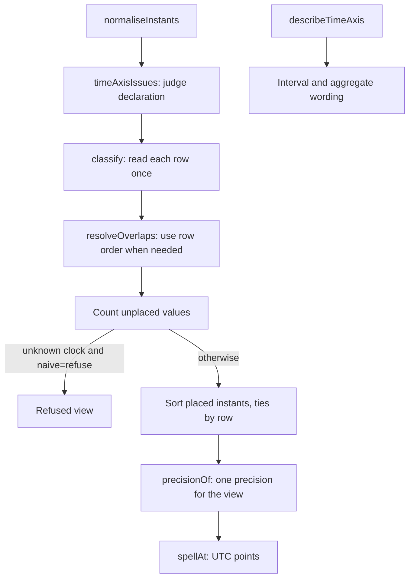

**Support** — private dataset time-axis helpers for parsing, normalization and wording; callers own the reader-facing result.

This private library supports the public [`axis.ts`](../axis.ts) facade. A
dataset declaration is judged without reading its rows; the read-side view then
places each value at a known instant or counts why it cannot. Stored rows are
never rewritten.

## Find the owner

| Module                         | One responsibility                                                                                                            |
| ------------------------------ | ----------------------------------------------------------------------------------------------------------------------------- |
| [`value.ts`](value.ts)         | Unknown-value record admission and bounded diagnostic wording.                                                                |
| [`wording.ts`](wording.ts)     | Duration adjectives, nouns and aggregate-list wording.                                                                        |
| [`instants.ts`](instants.ts)   | Exact decimal epochs, representable instants, shared precision and UTC spelling.                                              |
| [`classify.ts`](classify.ts)   | Read one row as missing, unreadable, naive, gap, overlap or instant, using the existing instant/zone grammars.                |
| [`overlaps.ts`](overlaps.ts)   | Resolve a fall-back overlap only when row order identifies its single step back.                                              |
| [`axis.test.ts`](axis.test.ts) | Public-facade composition: exact negative epochs and stable ties, nanosecond overlap notes, declaration identity and wording. |

Public types, constants, JSDoc and the four public function bodies remain in the
facade. The original contract, property, hostile-input and read-budget tests
remain in [`test/time/axis.test.ts`](../../../test/time/axis.test.ts).

## Follow the logic

The diagram describes existing function calls and decisions; it adds no runtime
chart or execution layer.

Only the facade and this folder import these helpers. Runtime dependencies flow
from the facade to these units, then to the existing time grammars; no grammar
is duplicated. `classify.ts` reads the facade's `DatasetTimeAxis` contract and
`instants.ts` its `AxisPrecision` contract through erased type-only imports, so
those references add no runtime cycle. `overlaps.ts` imports only the private
classification type. All units remain in the existing L0 `time/` layer.

## Cleanup step

This is Stage A, step 1: whole private helpers, constants and the private
classification type moved without changing their bodies. The facade keeps the
public declaration judge, declaration reader, description and normalization
orchestration intact. There is no Stage B decision or lifecycle rewrite in this
change. The former oversized-file exception is removed once the facade is below
600 lines; each extracted unit is also below that limit.
