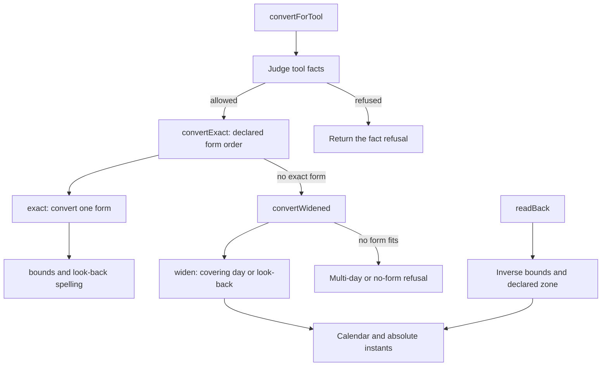

**Support** — private period-conversion helpers; callers own the tool selection and reader-facing result.

# Period conversion helpers

The public [`convert.ts`](../convert.ts) facade keeps its declarations,
documentation, exact-before-wider search and read-back entry points. These
modules contain whole private units moved from that file.

| Module | One responsibility |
| --- | --- |
| [`calendar.ts`](calendar.ts) | Calendar arithmetic, wall/date spelling and unique calendar instants. |
| [`instants.ts`](instants.ts) | Millisecond instants and absolute half-open window ranges. |
| [`bounds.ts`](bounds.ts) | Form zones and the existing bound write/read conversion table. |
| [`lookback.ts`](lookback.ts) | Exact look-back spelling in the form's declared units. |
| [`exact.ts`](exact.ts) | One form's existing exact conversion. |
| [`widen.ts`](widen.ts) | Covering day/look-back conversions and their extra ranges. |
| [`convert.test.ts`](convert.test.ts) | Public composition across rounding, DST, form caps and retention. |

The diagram documents existing calls and decisions; no runtime chart is added.
The facade retains its per-form cap search. `bounds`, `lookback`, `exact` and
`widen` read the shared calendar/instant units; none imports another stage or a
neighbouring sealed folder. Grammar stays in the existing parent time modules.
References to facade contracts are type-only and add no runtime cycle.

Stage A, step 1 only: private declarations move whole, with their bodies and
comments preserved. Public functions, public types, re-exports and JSDoc stay
in the facade. No Stage B algorithm, lifecycle or form-order rewrite is made.
The original cases remain in [`test/time/convert.test.ts`](../../../test/time/convert.test.ts)
and [`test/time/widen.test.ts`](../../../test/time/widen.test.ts).
